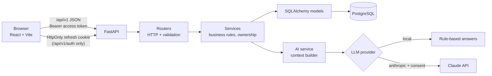
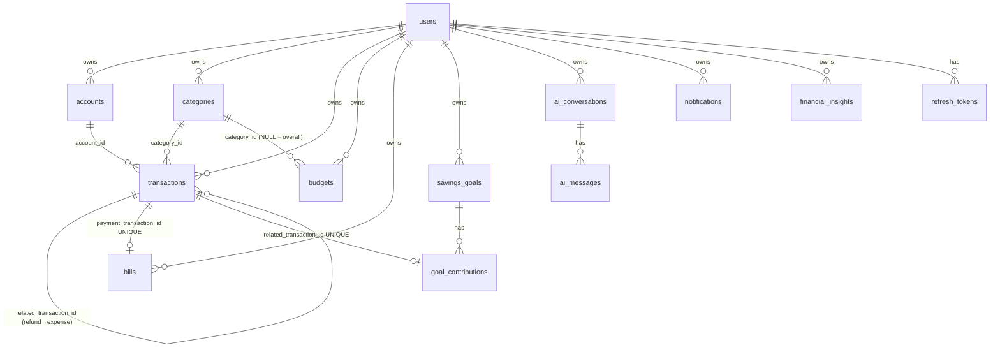
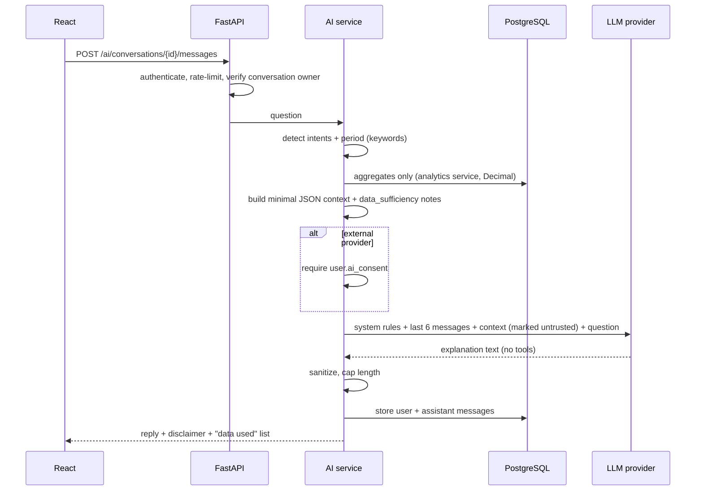

# Architecture & Design Decisions

This document records how the brief (v2.0) was implemented and every decision taken where the brief left
room for interpretation.

## 1. System architecture

Layering (backend/app): `routers` (HTTP only) → `schemas` (Pydantic validation) → `services` (all business
rules and ownership checks) → `models` (persistence). `core` holds config, security, dependencies, errors, and
rate limiting.

## 2. Data model (ER)

- **Primary keys:** UUID everywhere (no guessable IDs).
- **Money:** `NUMERIC(14,2)` + Python `Decimal`; JSON sends money as strings (`"1250.50"`).
- **Key constraints:** positive amounts (`CHECK amount > 0`); the transfer row shape (direction + group, no
  category); a refund must reference its original; `UNIQUE(user_id, category_id, month, year)` plus a
  **partial unique index** `(user_id, month, year) WHERE category_id IS NULL` for the overall budget;
  `bills.payment_transaction_id UNIQUE`; `CHECK status <> 'paid' OR payment_transaction_id IS NOT NULL`;
  `UNIQUE(user_id, dedupe_key)` on notifications and insights.
- **Indexes:** `user_id`, `(user_id, transaction_date)`, `(user_id, transaction_type, transaction_date)`,
  `(user_id, category_id)`, `(user_id, due_date)`, `(user_id, status)`, `(user_id, is_read)`.
- **Deletion rules:** financial FKs are `RESTRICT`. Accounts and categories that are in use are deactivated
  (soft) instead of deleted. User deletion removes rows in dependency order in one transaction.

**Additions to the brief's schema:** `refresh_tokens` (rotation/revocation), `transactions.direction`
(transfer leg), `categories.is_default`, `bills.category_id` and `notes`, `notifications.dedupe_key`,
`financial_insights.dedupe_key`, and notification/consent preference columns on `users`.

## 3. Financial ledger rules (decisions)

| Type | Balance effect | Counted as |
|---|---|---|
| income | + amount | income |
| expense | − amount | expense |
| refund | + amount | **reduces expense** (never income), in the period it is dated, under the original expense's category |
| transfer (two rows, same `transfer_group_id`) | out leg −, in leg + | **excluded** from income/expense/savings rate |

- `net expense = gross expense − refunds`; `net cash flow = income − net expense`.
- `savings rate = net cash flow / income × 100`, or `null` (shown as "n/a") when income is 0.
- `account balance = opening + income − expense + refunds + transfers in − transfers out`.
- **Pending transactions:** the MVP has no pending state; every recorded transaction is posted.
- **Refund limits:** total refunds ≤ the original expense; a refund can't be dated before its expense; an expense
  with refunds can't be deleted or reduced below the refunded amount.
- **Bills:** paying creates exactly one expense and links it (UNIQUE + row lock). Paying twice returns 409.
  Deleting the payment transaction returns the bill to `pending`. A paid bill can't be deleted. "Overdue" is
  derived (pending and past due in the user's timezone). Recurring bills create the next bill when paid.
- **Overall budget:** an independent limit compared with **all** net expenses of the month. It is never
  summed with category budgets.
- **Budget status:** `ok` < threshold (default 80%, user-configurable) ≤ `warning` < 100% ≤ `exceeded`.
- **Savings goals:** no stored `current_amount`; progress = Σ contributions / target. The display caps at 100%
  but the real total is kept. A contribution is never an expense. If it represents real money movement, it
  creates a linked transfer (excluded from totals). Deleting the contribution deletes that transfer. The goal
  auto-completes when the target is reached.
- **Projection:** required monthly = remaining / whole months left (a partial month rounds up). On-track
  compares this with the average contribution over the last 3 months. The assumptions are explained in the UI.
- **Bill comparison:** vs the most recent earlier non-cancelled bill of the same type; `null` without history.
- **Rounding:** money is quantized to 2 dp; percentages to 1 dp; both use ROUND_HALF_UP.
- **Dates:** transaction dates are calendar dates in the user's timezone. "Today" and month boundaries use the
  user's timezone; timestamps are stored in UTC.
- **Currency:** each user and account stores a currency code (default BDT). The MVP does not convert;
  changing the display currency only changes formatting.

## 4. Security plan (as implemented)

- **Passwords:** Argon2id. Login errors are generic, and verification still runs for unknown emails to keep
  timing similar.
- **Tokens:** the access JWT lasts 15 min and is held in JS memory only. The refresh token is a random 48-byte
  value in an `HttpOnly; SameSite=Strict; Path=/api/v1/auth` cookie (`Secure` in production). Only its
  SHA-256 hash is stored. It rotates on every refresh; re-using an old token revokes the whole token family.
  Logout revokes the family.
- **CSRF:** SameSite=Strict, plus `/auth/refresh` and `/auth/logout` require `X-Requested-With: XMLHttpRequest`.
- **Ownership:** every service query filters by the authenticated `user_id` (never a client-supplied one).
  Foreign records return 404. Referenced accounts, categories, and expenses are ownership-checked too.
- **Validation:** Pydantic (max 2 decimals, positive amounts, enums, lengths) plus DB CHECK/UNIQUE constraints.
  Only ORM queries are used, no raw SQL from input.
- **Headers/CORS:** CORS allows trusted origins only; `nosniff`, `X-Frame-Options: DENY`, `Referrer-Policy`,
  and `Cache-Control: no-store` on API responses. API docs are disabled in production.
- **Rate limits:** auth endpoints (per IP) and AI messages (per user), 10/min by default.
- **CSV export** neutralises spreadsheet formula injection.
- **Logging:** only operational events; no passwords, tokens, keys, or financial details.

## 5. AI data flow

- **Never sent to the model:** name, email, passwords, tokens, transaction descriptions, raw transaction lists.
- **Prompt injection:** user-entered names inside the context are labelled untrusted data. The model has no
  tools, so it can't act.
- **Failures:** provider errors become a safe message; details are only logged.
- **Insufficient data:** the context carries explicit notes, and the local provider says so directly.

## 6. API

Base `/api/v1` (all private routes require a Bearer token).

| Area | Endpoints |
|---|---|
| Auth | `POST /auth/register`, `POST /auth/login`, `POST /auth/refresh`, `POST /auth/logout`, `GET /auth/me` |
| Profile | `GET/PATCH/DELETE /users/me` (DELETE requires `{"password"}`) |
| Accounts | `GET/POST /accounts`, `GET/PATCH/DELETE /accounts/{id}` |
| Categories | `GET/POST /categories`, `PATCH/DELETE /categories/{id}` |
| Transactions | `GET/POST /transactions`, `GET/PATCH/DELETE /transactions/{id}`, `POST /transactions/transfers` — list supports `page, page_size (≤100), sort, search, start_date, end_date, account_id, category_id, type` |
| Budgets | `GET/POST /budgets` (`?month&year`), `GET/PATCH/DELETE /budgets/{id}` |
| Bills | `GET/POST /bills` (`?status=pending\|paid\|overdue\|upcoming\|cancelled`), `GET/PATCH/DELETE /bills/{id}`, `POST /bills/{id}/pay` |
| Savings | `GET/POST /savings-goals`, `GET/PATCH/DELETE /savings-goals/{id}`, `POST /savings-goals/{id}/contributions`, `DELETE /savings-goals/{id}/contributions/{cid}` |
| Analytics | `GET /analytics/summary`, `/trends` (`granularity=day\|week\|month`), `/categories` (`type`), `/cash-flow`, `/export.csv` |
| AI | `GET /ai/status`, `GET/POST /ai/conversations`, `GET/DELETE /ai/conversations/{id}`, `POST /ai/conversations/{id}/messages` |
| Insights | `GET /insights`, `PATCH /insights/{id}` |
| Notifications | `GET /notifications`, `PATCH /notifications/{id}`, `POST /notifications/mark-all-read` |

Endpoints added beyond the brief: `/ai/status`, `/analytics/export.csv`, contribution deletion, and
mark-all-read.

## 7. Frontend page map

`/login`, `/register` (guest only) → protected layout (sidebar on desktop, drawer on mobile):
`/` Dashboard · `/accounts` (accounts + categories) · `/transactions` · `/budgets` · `/bills` · `/savings` ·
`/analytics` · `/assistant` · `/notifications` · `/settings`.

Every data page has loading, error-with-retry, empty, and success (toast) states. Destructive actions use a
confirmation dialog. Charts include legends, tooltips, and screen-reader text summaries.

## 8. Known limitations / next steps

- Notifications and insights are generated on request (no background scheduler or email/push yet).
- The rate limiter is in-memory (single process).
- No multi-currency conversion.
- The local AI provider is keyword-based. Claude gives richer answers once a key and consent are in place.
- Version 2 items from the brief (OCR, auto-categorisation, recurring transactions, forecasting, PDF reports,
  bank integrations) are not implemented.
